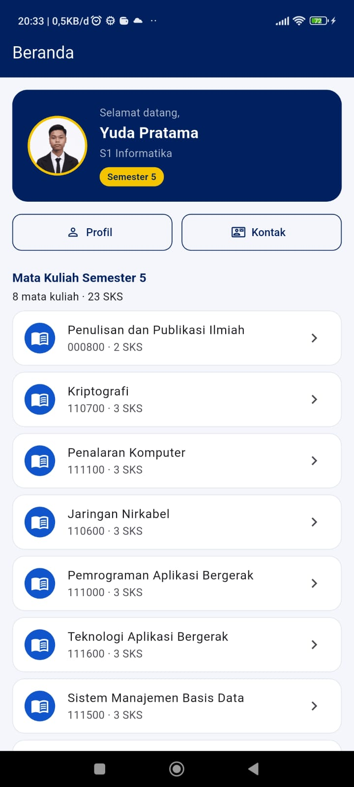
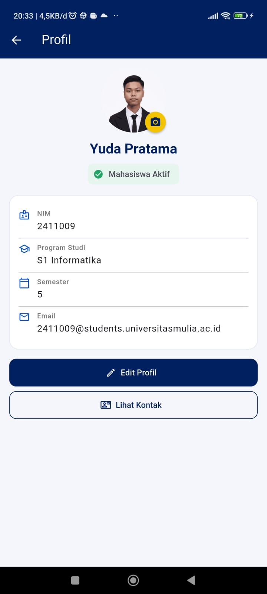
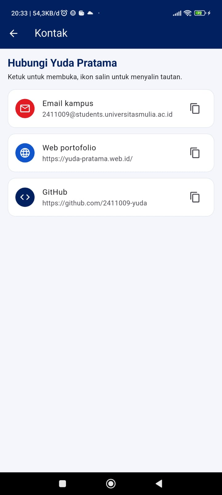

# Profil Mahasiswa (Flutter)

Tugas **Pemrograman Aplikasi Bergerak** - Universitas Mulia, Program Studi Informatika.
Praktikum **Materi 5: Navigation, Lifecycle & ViewModel**.

| | |
|---|---|
| Nama | Yuda Pratama |
| NIM | 2411009 |
| Program Studi | S1 Informatika |
| Semester | 5 |
| Email | 2411009@students.universitasmulia.ac.id |
| GitHub | https://github.com/2411009-yuda |
| Portofolio | https://yuda-pratama.web.id/ |

## Screenshot

| Beranda                                      | Profil (Edit) | Kontak |
|----------------------------------------------|---|---|
|  |  |  |

## Fiturx

- **4 layar** dengan route jelas: Beranda (`/`), Profil (`/profil`), Detail Mata Kuliah (`/mata-kuliah`), Kontak (`/kontak`).
- **ViewModel** (`ChangeNotifier` + `provider`) menyimpan nama, program studi, foto, dan logika validasi.
- **Edit Profil**: form nama & program studi dengan validasi; tombol Simpan aktif hanya saat input valid.
- **Ganti foto profil** dari galeri atau kamera, dengan opsi kembali ke foto bawaan.
- **Layar Kontak** (tugas tambahan): email, web portofolio, dan GitHub; ketuk untuk membuka, ikon salin untuk menyalin.
- **Pemantau lifecycle & orientasi** di Beranda (`WidgetsBindingObserver`).
- Tema mengikuti warna Universitas Mulia: navy `#002060`, merah `#E31B23`, kuning `#F4C400`.

## Pemetaan Compose (materi) ke Flutter

| Konsep di materi | Padanan di project ini |
|---|---|
| Destination / Route | `AppRoutes` di `lib/app/routes.dart` |
| NavHost | `onGenerateRoute` di `lib/app/app_router.dart` |
| `navController.navigate()` | `Navigator.pushNamed(context, route)` |
| Back stack / tombol kembali | `Navigator` + `Navigator.pop` / `BackButton` |
| Kirim data seperlunya | `arguments: course.id` (hanya id) |
| ViewModel | `ProfileViewModel extends ChangeNotifier` |
| `collectAsState` / observe state | `context.watch<ProfileViewModel>()` |
| Event ke ViewModel | `context.read<ProfileViewModel>().updateProfile(...)` |
| Lifecycle observer | `WidgetsBindingObserver` di `lifecycle_badge.dart` |

> Catatan: di Flutter, `State` widget tidak ikut hilang saat layar dirotasi (berbeda dengan Activity Android).
> ViewModel tetap penting karena state-nya dipakai bersama oleh banyak layar dan tidak hilang saat sebuah layar di-pop.

## Struktur Folder

```
lib/
  main.dart
  app/        app.dart, app_router.dart, routes.dart, theme.dart
  models/     student.dart, course.dart
  viewmodels/ profile_viewmodel.dart, course_data.dart
  screens/    home_screen.dart, profile_screen.dart, edit_profile_dialog.dart,
              course_detail_screen.dart, contact_screen.dart
  widgets/    um_widgets.dart, profile_avatar.dart, lifecycle_badge.dart
  utils/      launcher.dart
test/         profile_viewmodel_test.dart, navigation_test.dart
docs/         PROGRESS.md, screenshots/
```

## Cara Menjalankan

Repository ini berisi kode aplikasi (`lib/`, `assets/`, `test/`). Folder platform dibuat oleh Flutter:

```bash
flutter create . --project-name profil_mahasiswa --platforms=android,ios
flutter pub get
flutter run
flutter test
```

Pengaturan platform tambahan:

- **iOS**: tambahkan ke `ios/Runner/Info.plist` agar foto bisa dipilih:
  `NSPhotoLibraryUsageDescription` dan `NSCameraUsageDescription` (isi: alasan penggunaan).
- **Android (opsional)**: bila tombol email/web tidak terbuka di Android 11+, tambahkan `<queries>` untuk `mailto` dan `https` di `AndroidManifest.xml`.
- Foto pilihan disimpan di memori (ViewModel), jadi kembali ke foto bawaan saat aplikasi ditutup penuh.

## Skenario Uji Manual (untuk screenshot)

1. Buka aplikasi: Beranda tampil dengan kartu sambutan dan daftar mata kuliah.
2. Beranda -> Profil -> Edit Profil: kosongkan nama (muncul pesan error, Simpan nonaktif), isi lagi lalu Simpan.
3. Tekan tombol kembali: Beranda menampilkan nama baru (state di ViewModel).
4. Putar layar: data tetap, label orientasi di Beranda berubah.
5. Tekan Home lalu buka lagi aplikasi: riwayat lifecycle bertambah.
6. Ganti foto dari galeri, lalu kembalikan ke foto bawaan.
7. Buka Detail Mata Kuliah, lalu Kontak.

## Data Mata Kuliah

Daftar di `lib/viewmodels/course_data.dart` mengikuti kurikulum semester 5 (8 mata kuliah, 23 SKS; Robotika tidak diambil).
Kode, nama, SKS, dan prasyarat berasal dari daftar kurikulum; deskripsi singkatnya hanya penjelasan umum, bukan teks resmi RPS.
